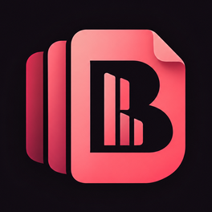
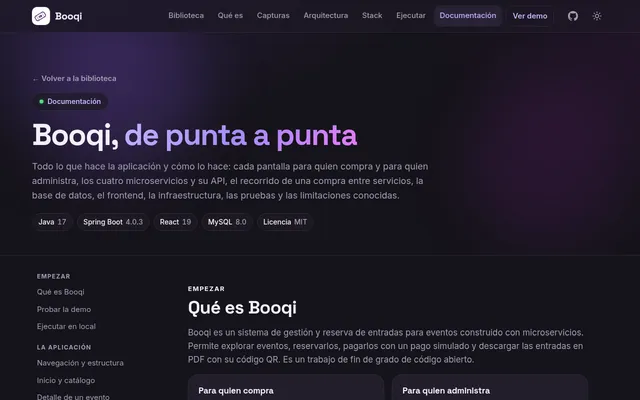
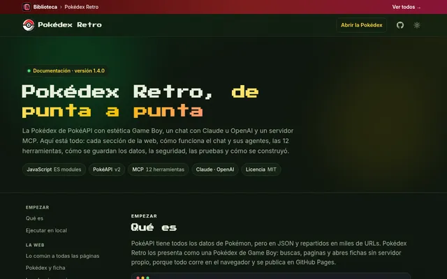
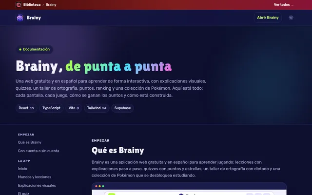

<div align="center">



# Biblioteca

**Toda la documentación de mis proyectos, en un mismo estante.**

Una web estática donde cada proyecto tiene su documentación completa —qué hace, cómo se usa y cómo
está hecho por dentro—, con capturas, en claro y en oscuro.


**[Abrir la biblioteca →](https://renzoramosdev.github.io/Documentacion-Proyectos-Renzo-Ramos/biblioteca/)**

</div>

---

## Qué es

Cada proyecto tiene su propio repositorio, pero su documentación vive aquí, en un solo sitio y con el
mismo formato. La **biblioteca** es una galería con una ficha por proyecto: su miniatura, una
descripción, sus tecnologías y los enlaces a su documentación, a su web y a su código. Se puede buscar
por nombre o tecnología y filtrar por tipo.

Cada documentación sigue el mismo orden —de lo que hace a cómo está hecho—, con un índice lateral que
marca dónde estás y una franja arriba para volver a la biblioteca.

## Proyectos

| | Proyecto | Qué es |
|---|---|---|
|  | **[AgentBoard](https://renzoramosdev.github.io/Documentacion-Proyectos-Renzo-Ramos/agentboard/)** | App de escritorio con el coste y la actividad de tus agentes de código (Claude Code, Codex, Copilot, Cursor, Gemini y OpenCode), en local y con servidor MCP. |
|  | **[Booqi](https://renzoramosdev.github.io/Documentacion-Proyectos-Renzo-Ramos/booqi/)** | Reserva de entradas para eventos con cuatro microservicios Spring Boot, MySQL y React. Trabajo de fin de grado. |
|  | **[Pokédex Retro](https://renzoramosdev.github.io/Documentacion-Proyectos-Renzo-Ramos/pokedex-retro/)** | La Pokédex de PokéAPI con estética Game Boy, un chat con Claude u OpenAI y un servidor MCP. |
|  | **[Brainy](https://renzoramosdev.github.io/Documentacion-Proyectos-Renzo-Ramos/brainy/)** | Web gratuita y en español para aprender jugando: explicaciones, quizzes, taller de ortografía, puntos y PokeBrainy. |

## Cómo está hecho

HTML, CSS y JavaScript sin frameworks ni build: cada carpeta se publica tal cual.

```text
.
├── biblioteca/            # la galería de proyectos (portada del sitio)
│   ├── index.html
│   ├── css/  js/
│   └── assets/            # logo, fuentes y miniaturas de cada documentación
├── agentboard/            # una carpeta por proyecto, con su documentación como index.html
├── booqi/
├── pokedex-retro/
├── brainy/
├── .github/workflows/
│   └── pages.yml          # publica el sitio en GitHub Pages
└── CLAUDE.md              # reglas del repo: estructura, commits y cómo añadir un proyecto
```

- **La biblioteca** calcula sola el número de proyectos, las secciones, los filtros y el estante del
  inicio a partir de las fichas.
- **Cada documentación** es independiente: lleva sus estilos, fuentes y capturas, con los colores de su
  proyecto.
- **Temas claro y oscuro** que siguen al sistema, accesibles y adaptados a móvil.

## Publicación

Cada push a `main` publica el sitio con GitHub Actions: se publican todas las carpetas visibles de la
raíz y una portada que redirige a la biblioteca. Una carpeta de proyecto nueva aparece sola, sin tocar
el workflow.

## Añadir un proyecto

1. Una rama con el nombre del proyecto.
2. Su documentación en una carpeta `<proyecto>/` como `index.html`, con la franja de la biblioteca
   arriba.
3. Sus miniaturas en claro y en oscuro y su ficha en `biblioteca/index.html`.
4. Commits `<Proyecto> N` y `Biblioteca N`, y a `main`.

El detalle de cada paso y las reglas de commits están en [`CLAUDE.md`](CLAUDE.md).

## Ver en local

```bash
python3 -m http.server 4321
# y abre http://localhost:4321/biblioteca/
```

Hay que servir la raíz del repo, no solo `biblioteca/`, para que funcionen los enlaces a cada
documentación.

## Autor

Hecho por **Renzo Ramos** · [GitHub](https://github.com/RenzoRamosDEV) ·
[LinkedIn](https://www.linkedin.com/in/renzoinv04/)
